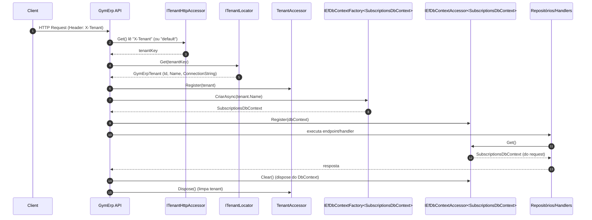

# Fluxo de resolução de Tenant (GymErp)

Este documento demonstra **como o tenant é resolvido por request** e como o `DbContext` “do tenant” é disponibilizado para repositórios/handlers.

## Visão geral

- A API recebe um request HTTP e lê o tenant a partir do header **`X-Tenant`**.
- Um `ITenantLocator` resolve o tenant (id, nome e connection string).
- O tenant resolvido é armazenado em um `TenantAccessor` (escopo do request).
- Em seguida, um middleware cria um `SubscriptionsDbContext` e registra esse contexto em um `IEfDbContextAccessor<SubscriptionsDbContext>`.
- Repositórios e `UnitOfWork` acessam o contexto “corrente” via `IEfDbContextAccessor.Get()`.

## Pipeline (ordem dos middlewares)

No `Program.cs`, o tenant é aplicado no pipeline com:

- `app.UseTenant()` (internamente encadeia `TenantAccessorRegisterMiddleware` e `TenantEfMiddleware`)

## Diagrama (sequência)



## Passo a passo (detalhado)

### 1) Ler o tenant do request

- O componente responsável é `DefaultTenantHttpAccessor`.
- Ele procura o header `X-Tenant`.
- Se não existir/estiver em branco, usa `"default"`.

### 2) Resolver detalhes do tenant (`ITenantLocator`)

O `TenantAccessorRegisterMiddleware` chama:

- `tenantLocator.Get(tenantKey, cancellationToken)`

O resultado é um `GymErpTenant` contendo:

- `Id`
- `Name`
- `ConnectionString`

> Nesta variante “with observability”, por padrão o container registra `ConfigTenantLocator`, que retorna sempre um tenant `"default"` com a connection string vinda da seção `DatabaseConnection` (cenário single-tenant/dev).

### 3) Registrar o tenant no escopo do request

- O middleware registra o resultado em `TenantAccessor.Register(tenant)`.
- Ao final do request, o `TenantAccessor` é limpo via `Dispose()`.

### 4) Criar e registrar o `DbContext` do request

No `TenantEfMiddleware`:

- `factory.CriarAsync(tenantAccessor.Tenant.Name)` cria um `SubscriptionsDbContext`
- `accessor.Register(contexto)` guarda esse contexto no `IEfDbContextAccessor`
- ao final: `accessor.Clear()` faz dispose/limpeza

### 5) Uso pelos repositórios e UnitOfWork

Repositórios/handlers **não recebem** `SubscriptionsDbContext` diretamente; eles recebem:

- `IEfDbContextAccessor<SubscriptionsDbContext>`

E usam:

- `var dbContext = accessor.Get();`

## Exemplo de request

```http
POST /enrollments
X-Tenant: default
Content-Type: application/json

{ ... }
```

## “Onde mexer” se você quiser evoluir para multi-tenant real

- **Fonte do tenant**: trocar/estender `DefaultTenantHttpAccessor` (header, subdomínio, claim etc.)
- **Resolução do tenant**: trocar `ConfigTenantLocator` por uma estratégia real:
  - via HTTP (ex.: `HttpTenantLocatorStrategy`)
  - via Postgres (ex.: `PostgresTenantLocatorStrategy`)
- **DbContext por tenant**: alterar a factory para usar `tenant.ConnectionString` (e não apenas o “DatabaseConnection” fixo)

