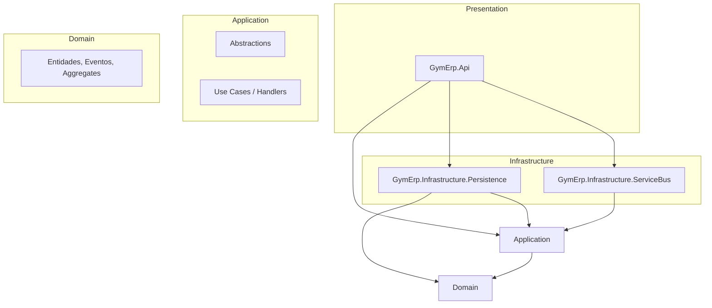

# GymErp · Clean Architecture

Este projeto segue **Clean Architecture** em .NET. O **Domain** contém regras de negócio puras; a **Application** executa casos de uso (handlers) orquestrando o domínio; **Infrastructure** e **Presentation** são detalhes (EF, HTTP, mensageria) plugados via interfaces definidas na Application.

---

## Camadas e responsabilidades

| Camada | Projeto(s) | Responsabilidade |
|--------|------------|-------------------|
| **Domain** | GymErp.Domain | Regras de negócio puras: entidades, value objects, eventos de domínio, agregados. Sem dependência de EF, ASP.NET, Kafka, etc. |
| **Application** | GymErp.Application | Casos de uso (handlers) que orquestram o domínio; define **abstrações** (interfaces) para persistência, mensageria, etc. Cada use case fica em `UseCases/<Feature>/` com interface, handler e DTOs. |
| **Infrastructure** | GymErp.Infrastructure.Persistence, GymErp.Infrastructure.ServiceBus | Implementa interfaces da Application com tecnologias concretas (EF, NoOp/Kafka). |
| **Presentation / UI** | GymErp.Api | Entry point: adapta HTTP para comandos/requests e chama a Application. |

---

## Regra de dependências

A dependência sempre aponta **para dentro** (em direção ao Domain):

- **Domain**: nenhuma referência a outros projetos da solution; apenas pacotes de biblioteca (ex.: CSharpFunctionalExtensions).
- **Application**: referência apenas a **Domain**; define as abstrações (interfaces) que a Infrastructure implementa e as interfaces dos use cases.
- **Infrastructure**: referências apenas a **Application** (e, quando necessário, Domain para tipos de entidade nos repositórios).
- **GymErp.Api**: referência **Application** e os projetos de **Infrastructure**; não referencia Domain diretamente (uso apenas via Application).

**Não fazer:**

- Domain não deve referenciar Application ou Infrastructure.
- Application não deve referenciar Infrastructure.
- Api não deve referenciar Domain diretamente; apenas via Application.

---

## Diagrama de dependências (Clean Architecture)



Resumo: **Domain** no centro; **Application** orquestra e define abstrações; **Infrastructure** implementa essas abstrações; **Api** é o entry point que monta comandos e chama a Application.

## Os círculos de Martin neste projeto

| Círculo (Robert C. Martin) | Onde está |
|---|---|
| Entities (regras de negócio da empresa) | `GymErp.Domain`: `Enrollment`, `Client`, states e eventos |
| Use Cases (regras de negócio da aplicação) | `GymErp.Application/UseCases`: interface, handler, request e response por caso de uso, mais `EnrollmentError` |
| Interface Adapters | `GymErp.Api/Controllers` e `GymErp.Api/Presentation/ResultHttp.cs` (controller e tradução para HTTP); `GymErp.Infrastructure.Persistence/EnrollmentRepository.cs` (gateway) |
| Frameworks and Drivers | ASP.NET Core, EF Core, Npgsql e o próprio PostgreSQL |

Regras que valem aqui:

- **Dependências só apontam para dentro.** Nada em Domain ou Application nomeia algo de fora. A Application não referencia ASP.NET, EF Core nem `Microsoft.Extensions`; o registro no container de DI fica na composition root da Api.
- **Estruturas simples cruzam a fronteira.** Os casos de uso recebem um request e devolvem `Result<Response, EnrollmentError>`; a entidade nunca sai da Application.
- **Quem traduz é o adaptador.** A Application diz *o que* aconteceu (`NotFound`, `RuleViolated`); `ResultHttp` decide que isso é 404 ou 422.
- **A regra é verificada.** `GymErp.Tests/Architecture/DependencyRuleTests.cs` quebra se Domain ou Application passarem a depender de algo de fora.

Concessões conscientes: o Domain usa a biblioteca CSharpFunctionalExtensions (biblioteca, não framework), e a Api referencia a Infrastructure só para montar a injeção de dependência no `Program.cs`.

---

## Use cases (Application)

| Interface | Descrição | Handler |
|-----------|-----------|---------|
| `IAddNewEnrollmentUseCase` | Nova inscrição | `AddNewEnrollmentHandler` |
| `ICancelEnrollmentUseCase` | Cancelar inscrição | `CancelEnrollmentHandler` |
| `ISuspendEnrollmentUseCase` | Suspender inscrição | `SuspendEnrollmentHandler` |

As interfaces dos use cases ficam em `UseCases/<Feature>/` junto do handler. A Presentation (Api) chama essas interfaces. Todos devolvem `Result<T, EnrollmentError>`, com `EnrollmentErrorKind.NotFound` ou `RuleViolated`.

## Abstrações (Application)

Interfaces que a Application define e a Infrastructure implementa:

| Interface | Descrição |
|-----------|-----------|
| `IEnrollmentRepository` | Persistência de inscrições (add, get, update) |
| `IUnitOfWork` | Transação / commit |
| `IEventPublisher` | Publicação de eventos de domínio |

Ficam na pasta `Abstractions/` do projeto Application.

---

## Onde estão as implementações (Infrastructure)

| Adapter | Projeto | Implementação |
|---------|---------|---------------|
| **HTTP** | GymErp.Api | Controllers montam comandos/requests e chamam as interfaces dos use cases |
| **Persistência** | GymErp.Infrastructure.Persistence | `EnrollmentRepository`, `UnitOfWork`, `SubscriptionsDbContext` (EF) |
| **Eventos** | GymErp.Infrastructure.ServiceBus | `NoOpEventPublisher` (hoje no-op; no futuro Kafka/Rabbit) |

Os eventos de domínio são despachados pela camada de persistência após `SaveChanges` (em `ServiceBusExtensions`), usando `IEventPublisher`; a Application não conhece o momento exato da publicação.

---

## Composition Root

Todo o registro é feito no **Program.cs** do projeto **GymErp.Api**:

- `AddUseCases()` · registra use cases e handlers. Fica em `GymErp.Api/CompositionRoot.cs`, para que a Application não dependa do container de DI.
- `AddPersistence(config)` · DbContext, `IEnrollmentRepository`, `IUnitOfWork`.
- `AddEventPublisher()` · `IEventPublisher` → `NoOpEventPublisher`.

---

## Estrutura da solution

- **GymErp.Domain** · entidades, eventos de domínio, agregados (`Common`: `IDomainEvent`, `Aggregate`); pasta `Enrollments/` com entidades e states.
- **GymErp.Application** · **Abstractions/** (interfaces `IEnrollmentRepository`, `IUnitOfWork`, `IEventPublisher`) e **UseCases/** (cada feature com interface do use case, handler e DTOs).
- **GymErp.Infrastructure.Persistence** · implementações EF (repositório, UoW, DbContext, dispatching de domain events).
- **GymErp.Infrastructure.ServiceBus** · implementação de publicação de eventos (NoOp; futuramente Kafka).
- **GymErp.Api** · host HTTP, Composition Root (`CompositionRoot.cs`) e tradução de resultado para HTTP (`Presentation/ResultHttp.cs`).
- **GymErp.Tests** · casos de uso exercitados com dublês das abstrações (sem banco) e testes da regra de dependência.
- **GymErp.IntegrationTests** · persistência real com PostgreSQL via Testcontainers (requer Docker). Cada etapa usa um `DbContext` novo.

## Como rodar os testes

```bash
dotnet test GymErp.Tests            # rápido, sem Docker
dotnet test GymErp.IntegrationTests # requer Docker
```
