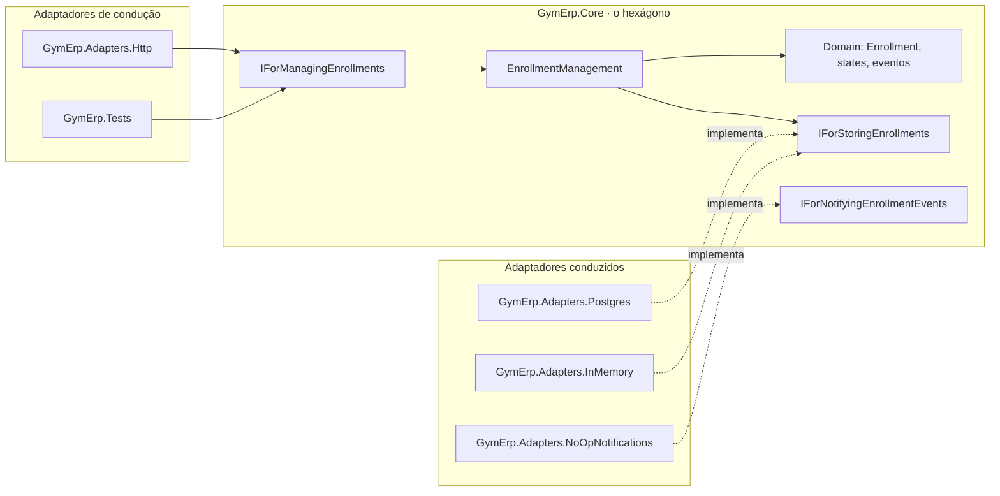

# GymErp · Arquitetura Hexagonal (Ports and Adapters)

Este projeto segue a arquitetura de Alistair Cockburn. A intenção do padrão, nas palavras dele:

> "Allow an application to equally be driven by users, programs, automated test or batch scripts, and to be developed and tested in isolation from its eventual run-time devices and databases."

Por isso há só dois lados: **dentro** (o hexágono, `GymErp.Core`) e **fora** (os adaptadores). O livro de 2024 (Cockburn e Garrido de Paz) resume: "Ports & Adapters only specifies two layers, inside and outside."

## Visão da arquitetura



## Portas

As portas são conversas com propósito, nomeadas pelo que a conversa faz, não pela tecnologia nem pelo padrão.

| Porta | Tipo | O que faz |
|---|---|---|
| `IForManagingEnrollments` | Condução | Matricular, cancelar e suspender. Implementada pelo próprio núcleo (`EnrollmentManagement`) |
| `IForStoringEnrollments` | Conduzida | Guardar e recuperar matrículas. Como e quando fazer commit é decisão do adaptador |
| `IForNotifyingEnrollmentEvents` | Conduzida | Avisar o mundo sobre eventos de domínio |

O que cruza as portas são estruturas simples (`EnrollRequest`, `CancelRequest`, `CancelResponse`, `SuspendRequest`) e `Result<T, EnrollmentError>`. A entidade nunca sai do hexágono pela porta de condução.

## Adaptadores

| Adaptador | Lado | Porta |
|---|---|---|
| `GymErp.Adapters.Http` | Condução | `IForManagingEnrollments`. Também traduz `EnrollmentError` para 404 e 422 (`Presentation/ResultHttp.cs`) |
| `GymErp.Tests` | Condução | `IForManagingEnrollments`, com o adaptador em memória: sem HTTP e sem banco |
| `GymErp.Adapters.Postgres` | Conduzido | `IForStoringEnrollments` com EF Core e PostgreSQL; publica os eventos pendentes depois do `SaveChanges` |
| `GymErp.Adapters.InMemory` | Conduzido | `IForStoringEnrollments` em memória; mesmo contrato de eventos |
| `GymErp.Adapters.NoOpNotifications` | Conduzido | `IForNotifyingEnrollmentEvents` que não avisa ninguém (hoje); Kafka ou RabbitMQ amanhã |

## Configurador

O `Program.cs` de `GymErp.Adapters.Http` é o único lugar que conhece todos os adaptadores. Ele escolhe o armazenamento por configuração:

```bash
dotnet run --project GymErp.Adapters.Http                    # PostgreSQL
dotnet run --project GymErp.Adapters.Http --Storage=InMemory # sem banco
```

## Regra de ouro

Se é possível trocar a tecnologia (EF por Dapper, Postgres por memória, NoOp por Kafka) e o `GymErp.Core` não muda, aquilo é adaptador. `GymErp.Tests/HexagonBoundaryTests.cs` quebra se o núcleo passar a referenciar qualquer coisa além da biblioteca `CSharpFunctionalExtensions`.

## Diferença em relação à solução Clean Architecture

O domínio é idêntico nas duas. O que muda é a ênfase de cada autor:

| | Ports and Adapters (aqui) | Clean Architecture |
|---|---|---|
| Lado de dentro | Um projeto, `GymErp.Core` | Dois projetos, Domain (entidades) e Application (casos de uso) |
| Entrada | Uma porta por conversa | Uma interface por caso de uso |
| Persistência | `IForStoringEnrollments`, commit no adaptador | `IEnrollmentRepository` mais `IUnitOfWork` |
| Armazenamento | Postgres e em memória, escolhidos por configuração | Postgres |
| Teste em destaque | O teste conduzindo a porta | A regra de dependência |

## Testes

```bash
dotnet test src/GymErp.Tests            # rápido, sem Docker
dotnet test src/GymErp.IntegrationTests # requer Docker; cada etapa usa um DbContext novo
```
